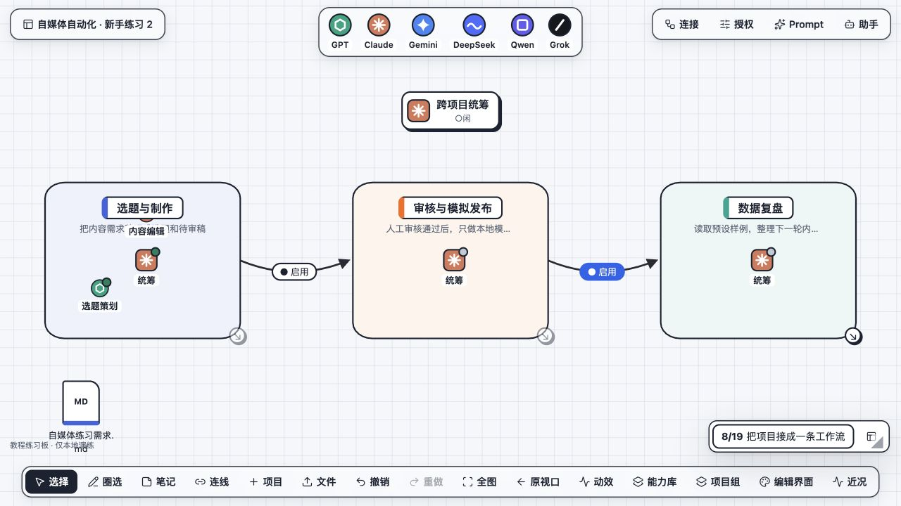
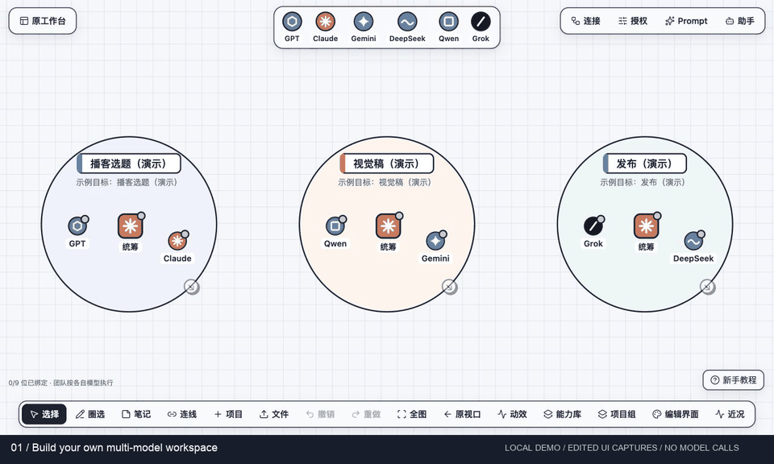

<div align="center">

# Relay

### Different models. One workspace you can actually control.

A local-first, editable canvas for multi-model agents, vibe coding, and everyday work.

[简体中文](README.md) · [Quick start](docs/QUICKSTART.md) · [Integrations](docs/INTEGRATIONS.md) · [Demo](docs/DEMO.md)


[](LICENSE)



</div>

**Alpha software.** Run it locally as a single-user web app. The tutorial needs no API key. Real inference requires your own provider configuration and may incur charges. The current UI is primarily Simplified Chinese; English localization is on the roadmap.

## A workspace, not just another chat

Draw a project, drop in files, assign agents their own models, and connect the results to another project. A coordinator plans the work, members execute dependencies, and a final pass produces artifacts. Downstream agents can read explicitly shared context and continue.

- **Build by hand:** freehand regions, optional circles and other shapes, resizable projects and panels, groups, notes, linked document readers, editable layouts and styles.
- **Choose per agent:** separate connection, exact model ID, and role. Configurable Responses, Chat Completions, and Anthropic Messages endpoints; custom relays are optional.
- **Stay in control:** pause, interrupt, change requirements, remove objects, undo and redo. Restoring objects never automatically restarts paid inference.
- **Follow the handoff:** shared content and triggers live on connections, with source receipts and project/group progress.
- **Use your files:** DOCX, XLSX, text-based PDF and plain text extraction. No scanned-PDF OCR promise.
- **Ask the built-in operator:** it uses software actions and observes results. Playwright MCP provides visible clicks, typing and dragging in a dedicated browser limited to Relay itself.
- **Explore safely:** a 19-step local media-workflow tutorial plus an integration tour, with numbered arrows. Scripted samples are clearly distinguished from real model execution.



This recording demonstrates local UI and tutorial behavior, not a paid autonomous-model benchmark. [MP4 and disclosure](docs/DEMO.md).

## Run locally

Install **Node.js 24+, npm, and Python 3** (`python3` on PATH).

```bash
git clone https://github.com/shian493719730-art/relay-agent-studio.git
cd relay-agent-studio
npm ci
npm run build
npm start
```

Open **http://127.0.0.1:4317/design-v2/**. Start with the tutorial at the lower right. For real work, open Connections, add your endpoint/protocol/exact model ID/key, test it, bind agents, then explicitly start a task. Connection tests can incur provider charges.

## Included and optional integrations

| Integration | Availability |
| --- | --- |
| Model connection layer | Included. Provider access and protocol compatibility determine usable models; brand icons do not certify model identity. |
| Custom API relay | Optional. No mandatory relay vendor. A relay may differ in quality, availability and data handling; its advertised model cannot be independently guaranteed. |
| Playwright MCP | Included npm dependency. Relay-origin browser control, pause and takeover. Not unrestricted desktop automation. |
| Skill / workflow library | 5,000+ source pointers and metadata, on-demand body reading, local search and recommendations. Listing, reading and runtime validation are distinct. Weekly checks require a scheduler. |
| Prompt optimization | Included intent-driven Skill selection with three original starter guides and custom local directories. Live refinement uses your model. [Snapper Assist](https://github.com/shian493719730-art/snapper-assist) is an optional separate app. |
| Auth Relay | Optional macOS adapter to an existing, separately installed and authorized app. That app is not distributed here. |

## Contribute

```bash
npm run typecheck
npm test
npm run build
npm run check:public
```

The release preparation passed a clean macOS install/build and 155 offline tests using mocked providers. CI is configured for Linux, macOS and Windows; consult actual runs before assuming platform support. See [Contributing](CONTRIBUTING.md), [Architecture](docs/ARCHITECTURE.md), [Roadmap](docs/ROADMAP.md) and [Security](SECURITY.md). Detailed guides currently include Chinese text; documentation translations are welcome.

Local single-user only: no hosted service, desktop installer, or multi-user access control yet. Keys are local server-side files, not an encrypted vault. Selected task/file content is sent to configured providers. See [Privacy](docs/PRIVACY.md).

MIT for project code and original guides. External Skills, dependencies and trademarks retain their own terms. [Third-party notices](THIRD_PARTY_NOTICES.md).
