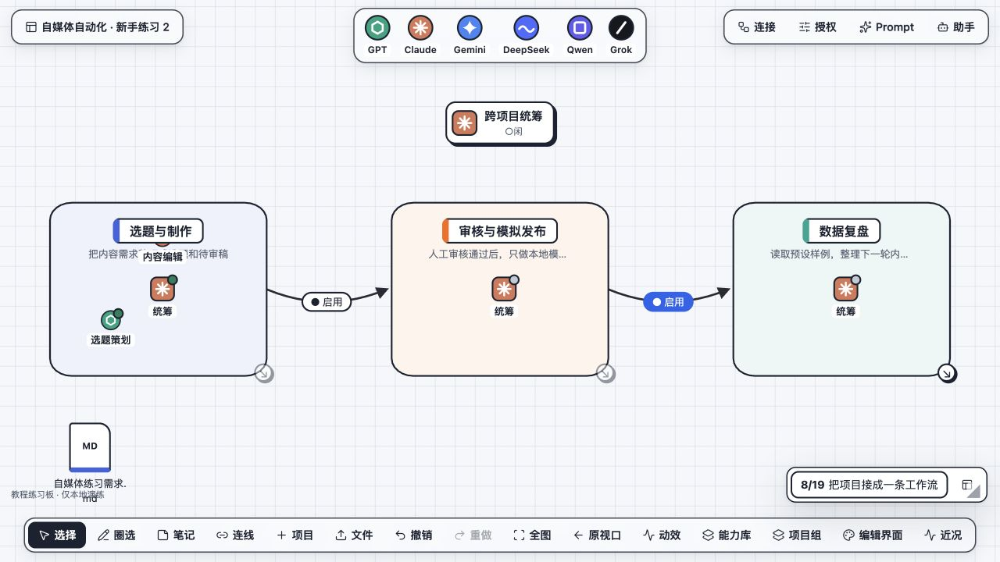
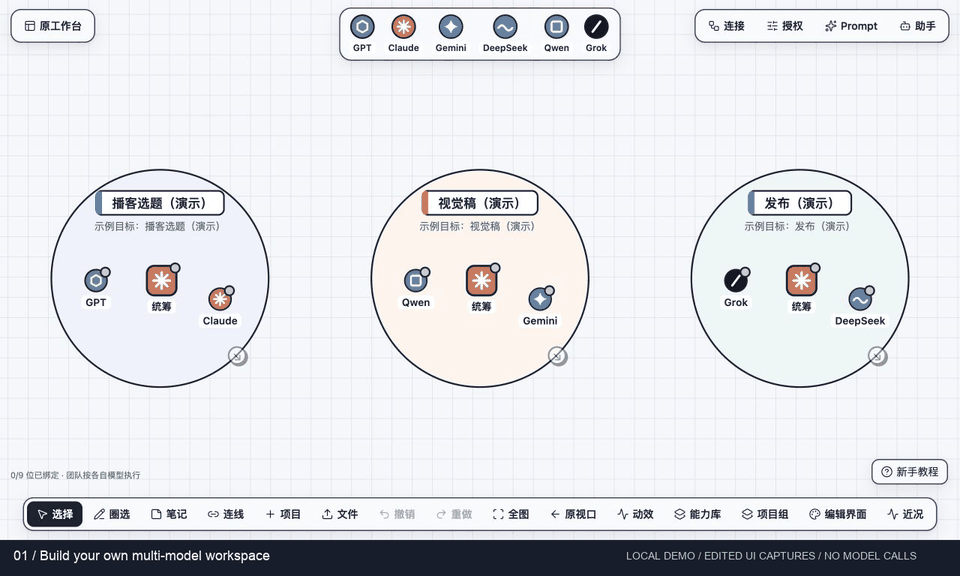

<div align="center">

# Relay

### 面向 vibe coder 的可视化办公软件。

用自然语言组织工作，在画板上亲手搭建。把文件、多模型团队、持续更新的 GitHub 资源与授权接力，放进同一条看得见、可打断的工作流。

[English](README.en.md) · [产品定位](docs/PRODUCT.md) · [快速开始](docs/QUICKSTART.md) · [插件与模型](docs/INTEGRATIONS.md) · [操作演示](docs/DEMO.md) · [路线图](docs/ROADMAP.md)


[](https://github.com/shian493719730-art/relay-agent-studio/actions/workflows/ci.yml)

[](LICENSE)



</div>

> **早期 Alpha，欢迎一起打磨。** 提供本地单用户桌面应用与源码部署；桌面包自带运行环境，无需 API 密钥就能体验教程和画板。真实模型执行需要自行配置 API，并产生对应供应商费用。

## 为 vibe coder 把办公流程搭起来

Relay 面向习惯用自然语言与 AI 一起解决问题、也愿意亲手调整工具的使用者。你可以整理需求文件、策划内容、分析工作材料、分派任务、审阅成果，再把结果交给下一个项目；工作过程都留在可编辑画板上。

你既能自己画项目、拖成员、改布局，也能把目标交给内置助手，让它使用软件动作执行并呈现结果。保留手工搭建的空间，AI 执行时也能暂停、接手和更改要求。

## 两项贯穿办公流程的能力

### GitHub 开源资源，持续发现、推荐与更新

内置 **5,000+ 条 Skill、Workflow、Agent 方法与工具来源索引**，围绕开发、文件处理、表格、写作、研究和自动化等任务寻找适合的方法。在「能力库」选择项目后，可以按目标、成员职责和文件类型获得推荐，再查看原仓库、许可、正文与审读状态，将合适的方法留作项目参考，或用于基于 Skill 的 Prompt 优化。

更新流程会检查所维护 GitHub 来源的仓库状态、许可元数据和目录变更，识别新增、变化、移除或归档的条目；失败时保留有效目录，避免把旧版本的审读结论套给新内容。支持**每周检查与手动刷新**，并显示更新状态。桌面版已内置应用运行时的每周调度，可暂停/开启；源码部署可显式启用本机调度，或使用自己的宿主任务。应用关闭时不会依赖后台云任务继续运行。

资源供给包括发现与适配，不把“被收录”直接等同于“已经安装、能够运行”。正文读取和实际运行验证分别记录，具体工具仍需其依赖、权限和许可。[资源库与更新说明 →](docs/INTEGRATIONS.md#skill--workflow-能力库内置目录)

### 内置 Auth Relay 授权接力入口

把此前开发的自动授权接力能力接到办公流程中：在顶部「授权」或内置助手中查看本机连接、已有授权范围与有效期，建立本站任务，处理验证断点，并在同一个接力任务上聚焦、接续或取消。遇到需要本人处理的步骤，用户可以接手，再回到原任务。

**Relay 已内置授权界面和任务桥接；实际授权服务由另行安装的 macOS Auth Relay 应用提供。** 未安装、未连通或现有授权暂停时会明确提示。接力沿用本人已有范围，不代替用户放宽权限，也不把教程当成真实授权。[自动授权如何接入 →](docs/INTEGRATIONS.md#auth-relay-自动授权接力可选外部应用)

## 你可以做什么

| 能力 | 当前行为 |
| --- | --- |
| **可编辑工作画板** | 自由绘制项目选区，保留原轮廓；切换圆形等形状，移动、缩放、分组，放笔记和文件阅读框。布局、组件和样式按画板保存。 |
| **各用各的模型** | 每位成员独立绑定连接、模型与职责。统筹拆解任务，成员按依赖执行，再汇总成果；不会把所有头像偷偷转给同一个模型。 |
| **项目之间继续工作** | 多个项目、组内项目与整组可连接。点击连线选择共享内容、触发条件；下游读取带来源的共享内容，继续执行。 |
| **文件成为工作材料** | 拖入 DOCX、XLSX、文本型 PDF 或文本，读取正文供成员使用，并在关联阅读框中浏览。扫描 PDF 暂不含 OCR。 |
| **随时接手** | 暂停、停止与更新要求；移动不打断无关任务。删除会停止受影响执行并保留已有记录，撤销恢复对象不会自动重启收费调用。 |
| **软件内的执行助手** | 理解目标、读取状态，调用可用的软件动作并观察回执。可视模式借助 Playwright MCP 在专用浏览器里展开、填写、点击与拖拽。 |
| **在画板中开发源码** | 连接 Git/npm 工程，由助手按具体需求安装依赖、读改源码、测试、检查实际应用预览和打包；步骤可暂停，本轮源码与依赖环境可恢复。桌面自带 Node/npm，保留手动编辑。也可开发 Relay 自己。[使用方法](docs/SELF_DEVELOPMENT.md) |
| **看得见的近况** | 打开画板、项目或项目组查看近期操作与进度。编辑支持删除、撤销、重做和恢复。 |
| **从零练习** | 19 步自媒体流程教程，带编号箭头；另有亮点功能导览。本地预设内容，不调用模型、不真实发布。 |



*由实际浏览器操作画面剪辑；这里展示本地教学与界面能力，不是付费模型的自主任务验收。[观看 MP4 与演示说明](docs/DEMO.md)。*

## 下载桌面版

从 [Releases](https://github.com/shian493719730-art/relay-agent-studio/releases) 下载适合系统与架构的包，安装后直接打开 Relay。无需安装 Node、Python 或 Codex；数据存放在独立用户目录，升级不覆盖已有项目。桌面版在应用运行时自动进行每周 GitHub 资源检查，可暂停并手动刷新。

**当前维护与验收范围为 macOS、Linux。Windows 仅保留实验性配置和历史附件，不作为兼容、CI 或发版的必需条件，也不承诺完整支持。** macOS 主要实机验证，Linux 完整交互仍待实机补验；[平台与验证范围](docs/PLATFORMS.md) 区分自动检查和人工验收。

也可以从「新手教程 → 用自然语言修改 Relay」体验软件操作助手代你读取源码、修改、真实测试、预览与回滚。本地课程明确使用预设工具流程，不运行模型；另有“准备真实AI开发”入口，把需求草稿和自己的仓库交给已配置模型，准备本身不调用模型。

每个人都能从「新手教程 → 人人都能自开发」走完8步真实源码练习：读文件、手动修改、测试、差异和回滚。桌面练习使用内置 Node，不需要 Git/npm、API 或下载依赖；完成后再连接自己的仓库。

源码开发入口在画板菜单和项目详情/聊天中。普通画板无需开发环境；运行源码检查另需本机 Git、Node/npm，Relay 构建还需 Python。源码连接和脚本权限由用户明确选择，操作助手不能自行扩大目录范围。

[本地安装、数据备份与更新 →](docs/DESKTOP.md) · [AGPL 许可与品牌规则 →](docs/LICENSING.md)

## 从源码开始

需要 **Node.js 24+、npm、Python 3**（`python3` 在 PATH 中）。

```bash
git clone https://github.com/shian493719730-art/relay-agent-studio.git
cd relay-agent-studio
npm ci
npm run build
npm start
```

打开 **[http://127.0.0.1:4317/design-v2/](http://127.0.0.1:4317/design-v2/)**，点击右下角「新手教程」。教程无需密钥。根路径保留早期工作台，主画板入口是 `/design-v2/`。

要开始真实任务：打开「连接」→ 添加官方或兼容 API → 填写 Base URL、协议、准确模型 ID 与密钥 → 检查连接 → 为每位成员绑定 → 明确开始执行。**连接检查也可能消耗额度。** 不需要购买特定中转站服务。

[完整安装、数据位置与更新方法 →](docs/QUICKSTART.md)

## 模型与办公能力接入

| 接入 | 交付方式 | 说明 |
| --- | --- | --- |
| GPT / Claude / Gemini / DeepSeek / Qwen / Grok 等 | 自带可配置连接层 | 支持 Responses、Chat Completions、Anthropic Messages；是否可用取决于供应商协议、准确模型 ID 和账号权限。品牌头像不是可用性保证。 |
| 自定义中转站 | 可选配置 | 任意兼容服务；银子 API 仅是可选推荐。中转无法证明上游真实模型，质量、稳定性与数据政策可能有差异。 |
| Playwright MCP | npm 依赖 | 专用浏览器内的真实可视操作，目前限定 Relay 自身来源；支持暂停和人工接手，不是全桌面键鼠控制。 |
| Skill / Workflow 能力库 | 内置目录 + 按需正文 | 收录 5,000+ 条来源索引与链接；目录收录、正文读取、运行验证分别标记。支持手动刷新；桌面版内置应用运行时的每周检查，源码部署可选。 |
| Prompt 优化 / Snapper Assist | 内置优化流程 + 可选独立应用 | 从需求选择 Skill、读取方法再优化；附 3 个项目自有基础 Skill，可扩展本地目录。实时优化需配置模型。 |
| Auth Relay 自动授权接力 | 可选 macOS 本机适配器 | 连接已安装且已有本人授权的外部应用，显示实际状态与范围；本仓库不包含该应用，不会默认授予权限。 |

[配置、授权、许可证与接入边界 →](docs/INTEGRATIONS.md)

## 一个具体流程

把需求文档放入「选题与制作」→ 统筹安排策划、编辑与审阅各用自己的模型 → 汇总成待审稿 → 通过连接交给「人工审核」→ 审核后的材料继续进入「数据复盘」。任一步都能暂停、更改要求和查看已有成果。

教程使用虚构材料和样例数据；真实社交平台发布、平台数据采集和任意外部业务自动化仍需相应集成，不能用教程完成来代替真实验收。

## 开发与参与

```bash
npm run dev        # 本地开发服务
npm run typecheck
npm test           # 离线单元/行为测试，模拟供应商，不调用收费模型
npm run build      # 生成沉浸式画板并构建 Web 资源
npm run check:public
```

当前包含 **194 项离线测试**，涵盖源码落盘、冲突保护、逐次回滚与停止真实检查进程。各提交的 [CI](https://github.com/shian493719730-art/relay-agent-studio/actions/workflows/ci.yml) 和 [实际打包后检查](https://github.com/shian493719730-art/relay-agent-studio/actions/workflows/desktop.yml) 分别记录结果。默认只要求 macOS、Linux，Windows 不阻塞验收或发布。自动化检查不等同于完整原生界面或收费供应商验收；历史报错与平台边界见 [验证说明](docs/PLATFORMS.md)。浏览器可视操作需要本机 Chrome；普通画板不需要 Playwright 浏览器安装。

欢迎提交复现清楚的 Bug、交互改进和新的连接适配器。开始前请阅读 [贡献指南](CONTRIBUTING.md)、[架构](docs/ARCHITECTURE.md)、[安全说明](SECURITY.md) 和 [行为准则](CODE_OF_CONDUCT.md)。我们尤其需要跨平台验证、无障碍、文件处理和协作恢复方面的贡献。

## 当前边界

本地单用户 Alpha，桌面分发包与源码入口并存；尚无多人权限系统或托管云服务。桌面版密钥保存在独立用户目录的服务端文件中，不是加密保险箱；请保护设备与备份，不把运行目录提交到 Git。选中的任务与文件内容会发送给你配置的供应商。[数据与隐私](docs/PRIVACY.md) 说明具体位置和网络行为。

AGPL-3.0-only 适用于本版本自有代码与指南；既有 MIT 版本保留原授权，见 [许可说明](docs/LICENSING.md)。第三方依赖、模型品牌和外部 Skill/Workflow 按各自许可与条款处理。感谢 [Microsoft Playwright MCP](https://github.com/microsoft/playwright-mcp)、[Lucide](https://github.com/lucide-icons/lucide)、React、Vite 以及各来源维护者；见 [第三方说明](THIRD_PARTY_NOTICES.md)。
