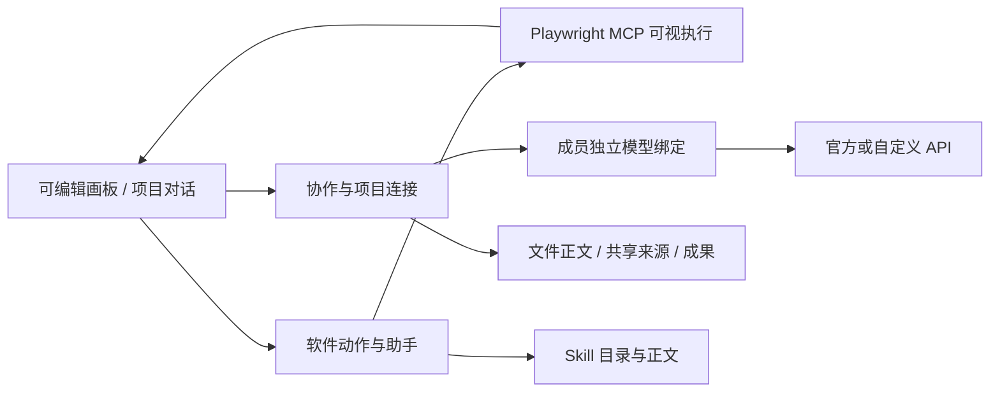

# 架构

## 目录

| 路径 | 责任 |
| --- | --- |
| `src/prototype/` | 主画板的维护源码：自由选区、连接、直接操控、文件、助手、可视操作和教程。 |
| `src/` | 早期 React 工作台与共用类型。根路径仍保留。 |
| `server/index.ts` | 回环地址 HTTP 服务、路由与取消生命周期。 |
| `server/canvas-runs.ts` | 规划、依赖成员执行、汇总、下游接续与持久记录。 |
| `server/model-connections.ts` / `model-stream.ts` | 独立连接、协议、流式调用与验证。 |
| `server/shared-context.ts` | 选定共享内容和来源。 |
| `server/documents.ts` / `document-worker.mjs` | 文件入库、隔离解析、状态与正文。 |
| `server/studio-assistant.ts` | 软件操作规划与可用动作契约。 |
| `server/browser-control.ts` | 官方 Playwright MCP 会话、同源限制、可视动作与接手。 |
| `server/skill-library.ts` / `library-refresh.ts` | 目录检索、正文、推荐和更新。 |
| `server/auth-bridge.ts` | 可选本机授权接力。 |
| `resources/` | 来源元数据、自有方法与基础 Skill。 |
| `tests/` | 模拟供应商、状态恢复、共享、文件和交互行为测试。 |

## 构建与状态

`npm run build` 从维护中的 HTML/CSS/JS 组装 `public/design-v2/index.html`，检查内联脚本、客户端网络入口和密钥，再做类型检查与 Vite 构建。不需要设计阶段的私人基线文件。生成的 HTML、`dist/` 和本机运行证据不提交。

服务端状态默认在 `.data/`；浏览器保存画板、视口、草稿、文件缓存和编辑历史。用户编辑是主要状态，轮询与 AI 不应覆写未点名字段。恢复对象不会恢复收费执行。断开、删除和停止分别有不同含义，不用全局禁止编辑代替取消生命周期。

## 扩展原则

每个功能同时有手动入口、可观察软件动作、明确影响范围和取消/撤销行为。API 完成不能代替实际界面检查。未知或未接入的外部能力明确报缺失，不生成伪成功。不要把无模型脚本回放包装成自主执行。

本地服务的回环绑定与同源限制不是多用户认证系统。远程服务化、账户隔离、加密密钥库和安装包属于后续工程。
