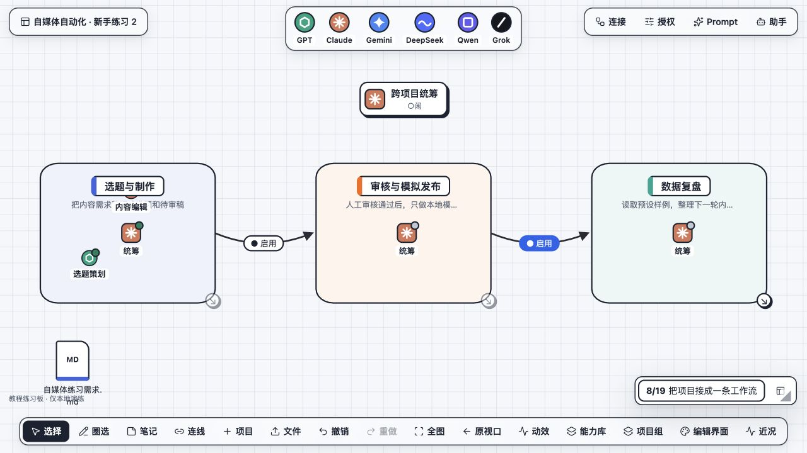

# 操作演示

[下载 / 观看操作视频 MP4](media/walkthrough.mp4) · [GIF 预览](media/walkthrough.gif)

## 这段演示展示什么

从干净、独立的本地安装打开 Relay，进入无密钥教程，建立虚构自媒体项目，浏览团队、连接与近况，以及能力库等就近面板。素材来自实际浏览器操作的 14 个界面时刻，剪成 42 秒步骤短片；不是连续实时录像或性能计时。

没有配置真实密钥，没有调用收费模型，没有连接个人业务数据，也没有真实发布内容。教程生成的稿件与指标是预设样例；不能据此判断模型质量、跨供应商稳定性或真实任务成功率。

## 你自己复现

1. 按 [快速开始](QUICKSTART.md) 安装并打开 `/design-v2/`。
2. 点击「新手教程」→「开始练习」，按编号箭头操作。需要时展开「使用内置练习示例」。
3. 用左上角切换画板，点项目标题查看详情/进入房间，点连线查看共享规则。
4. 打开「近况」「能力库」「Prompt」「讲解员」查看对应能力和配置提示。
5. 真实任务另行配置 API，并主动开始；不要把教学板中的预设内容当成供应商返回。

重新练习可新建独立教学板，不需要清理自己的工作区。
